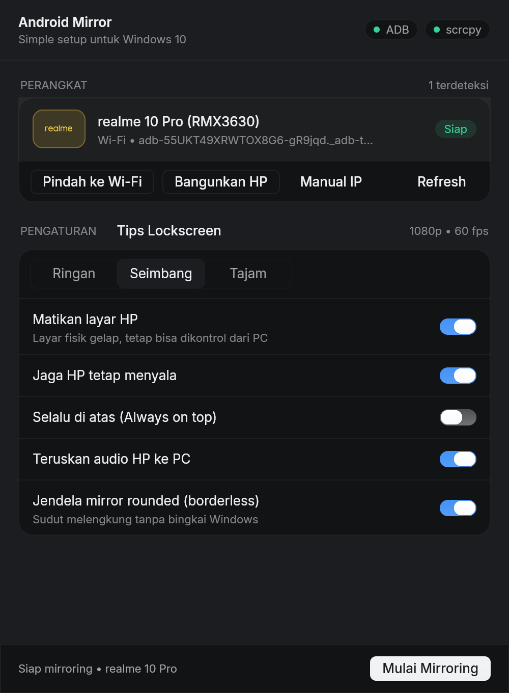

# Android Mirror

Aplikasi desktop Windows yang ringan dan minimalis untuk mirroring layar Android ke PC menggunakan **ADB** dan **scrcpy**, dibangun dengan **Rust** dan framework UI native [**Rune**](https://github.com/anomalyco/rune).

<p align="center">
  
</p>

---

## Fitur Utama

- **Plug & Play (Auto-Setup `adb` & `scrcpy`)**
  Otomatis mendeteksi instalasi `adb`/`scrcpy` di sistem, atau mengunduhnya langsung dari rilis resmi GitHub dalam 1 klik (`%LOCALAPPDATA%\AndroidMirror\bin`).
- **USB & Wireless (Wi-Fi) Mirroring**
  - Pindah dari koneksi USB ke Wi-Fi (`tcpip 5555`) dengan 1 klik (*Pindah ke Wi-Fi*).
  - Dukungan koneksi IP:Port manual (*Wireless Debugging* Android 11+).
  - Deteksi merek perangkat otomatis (ikon SVG bawaan untuk Realme, Xiaomi/Redmi, Oppo, Vivo, Samsung, Google/Pixel, OnePlus, Poco, Asus, Honor, Huawei, Motorola, Sony).
- **Monitoring Perangkat Real-Time**
  Menampilkan **CPU Usage (%)**, **GPU Usage (%)** *(jika diizinkan oleh sistem/kernel non-root)*, serta **Suhu Baterai (°C) & Level Baterai (%)** langsung di kartu perangkat.
- **Mode Jendela Mirroring Fleksibel**
  - **Standar (Dark Title Bar):** Bar judul gelap Windows 10 dengan nama perangkat, tombol minimize, dan close.
  - **Rounded Borderless + Thin Bar:** Sudut jendela melengkung (*rounded*) dengan bar atas tipis (`26 px`) yang dapat di-drag, di-minimize, dan di-close, serta sinkron otomatis dengan *Z-order* Windows.
- **Preset Kualitas & Opsi Lengkap**
  - Preset kualitas: **Ringan** (`720p • 30 fps`), **Seimbang** (`1080p • 60 fps`), dan **Tajam** (`Resolusi asli • 60 fps`).
  - Matikan layar fisik HP saat mirroring (`--turn-screen-off`), jaga tetap menyala (`--stay-awake`), selalu di atas (*Always on top*), dan teruskan audio HP ke PC.
  - Tombol **Bangunkan HP** (`KEYCODE_WAKEUP`) & **Tips Lockscreen** (panduan *Blind Unlock* dan catatan `FLAG_SECURE`).
- **System Tray & Auto-Cleanup**
  Menutup jendela aplikasi akan meminimalkannya ke System Tray tanpa memutus sesi; keluar lewat menu Tray (*Keluar*) otomatis menghentikan proses `scrcpy` yang aktif.

---

## Struktur Proyek

```text
android-mirror-app/
├── assets/
│   └── brands/          # Ikon SVG merek perangkat Android (di-embed saat build)
├── docs/
│   ├── preview.png      # Screenshot tampilan aplikasi
│   └── prototype.html   # Prototipe interaktif UI (HTML/CSS)
├── src/
│   ├── main.rs          # UI Rune, state management, background polling & system tray
│   ├── adb.rs           # Integrasi ADB/scrcpy, installer otomatis & telemetry HP
│   └── win.rs           # Kustomisasi jendela Win32 (dark bar, rounded thin bar, work-area center)
├── build.rs             # Code generator untuk meng-embed assets/brands/*.svg
├── Cargo.toml           # Konfigurasi crate & dependensi Rune
├── Cargo.lock
├── LICENSE
└── README.md
```

---

## Prasyarat

1. **Windows 10 / 11 (64-bit)**.
2. **HP Android dengan USB Debugging aktif:**
   - Buka *Setelan → Tentang ponsel → ketuk Nomor Build 7x*.
   - Masuk ke *Opsi Pengembang* → aktifkan **USB Debugging**.
   - **Khusus HP Realme / OPPO (ColorOS):** Aktifkan juga **Disable permission monitoring** di paling bawah menu *Opsi Pengembang* agar kontrol input dan *clipboard sync* berfungsi normal.
3. **Jika build dari source:** [Rust toolchain](https://rustup.rs/) (MSVC target di Windows).

---

## Build & Menjalankan dari Source

```powershell
git clone https://github.com/Svel2/android-mirror.git
cd android-mirror
cargo build --release
```

Setelah selesai, jalankan file binary hasil kompilasi:

```powershell
.\target\release\android-mirror-app.exe
```

Atau langsung jalankan dalam mode development:

```powershell
cargo run
```

---

## Shortcut & Catatan Penggunaan

- **Clipboard Sync (Copy/Paste 2 Arah):** Sudah aktif bawaan `scrcpy`. Teks yang di-**Copy** di HP otomatis masuk ke clipboard Windows (`Ctrl + V`), dan teks yang di-copy di Windows bisa di-paste ke HP dengan `Ctrl + V` (atau `Ctrl + Shift + V` untuk menyalin ke clipboard HP saja).
- **Mematikan / Menyalakan Layar Mirror:** Tekan `Alt + O` pada jendela mirroring untuk mematikan layar fisik HP tanpa mengunci HP.
- **Layar Hitam Saat Lockscreen (`FLAG_SECURE`):** Android memblokir tampilan layar kunci dan aplikasi perbankan untuk keamanan. Gunakan *Blind Unlock* dari keyboard PC (**Spasi** → ketik **PIN** → **Enter**) atau hindari menekan tombol Power fisik saat mirroring berlangsung.

---

## Lisensi

Proyek ini dirilis di bawah lisensi [MIT](LICENSE).
